<p align="center">
  
</p>

# compass_ws — бортовое ПО робота

ROS 2 workspace со всем, что работает на ПК робота: сервисная часть для **Compass** (веб-консоль
обслуживания), агент **VDA 5050** для работы с fms, общие интерфейсы и сторонние пакеты в
зафиксированных версиях. Workspace переносится на робот целиком и собирается там одной командой.

**Стек:** Ubuntu 24.04 · ROS 2 Jazzy · Nav2 · slam_toolbox · C++.

## Как устроено

```
   Compass UI (браузер)                                    fms
          │ HTTP + WebSocket                                │ MQTT, VDA 5050 v3
┌─────────┼──────────────── ПК робота ──────────────────────┼─────────────────┐
│  compass_web ┴ /rosbridge ─► rosbridge (apt)              │                 │
│                               │ ROS 2                     │                 │
│     compass_core ◄────────────┘           vda5050_adapter ┘                 │
│     режим работы, карты, конфиг,  ──/robot/operating_mode──►                 │
│     джойстик, СТОП                ◄──/robot/maps/activate───                 │
│           │                                     │          │                 │
│           ▼                                     ▼          ▼                 │
│     ros2_task_orchestrator ──► докинг, лифт,   Nav2: FollowPath по рёбрам    │
│     (сервисные цели, функции)  зарядка, цели                                 │
└──────────────────────────────────────────────────────────────────────────────┘
```

- **Compass** обслуживает робота: картографирование, ручное управление, настройки. Подключается
  к роботу по HTTP и WebSocket через `compass_web` — свой веб-сервер, nginx не нужен.
- **fms** управляет флотом: шлёт order'а по VDA 5050, агент едет строго по рёбрам графа.
- **Кто командует роботом**, решает режим работы — `operatingMode` из VDA 5050:

| Режим | Кто командует |
|---|---|
| `AUTOMATIC` | fms через агента |
| `INTERVENED` | оператор посреди order'а (order сохраняется) |
| `MANUAL` | оператор, ручная езда |
| `SERVICE` | оператор, обслуживание |
| `TEACH_IN` | оператор, построение карты |

Подробно — в документации (ниже).

## Пакеты

| Пакет | Что | Состояние |
|---|---|---|
| `robot_interfaces` | общие msg/srv: режим, статус, аренда управления, джойстик, поза, скан, карты, навигация, журнал, настройки | ✅ этап 4 |
| `compass_core` | сервисная часть: режим работы, статус, аренда управления, джойстик, поза, скан, картографирование, библиотека карт, активная карта и локализация, сервисные цели через task_orchestrator; журнал WARN+, настройки робота (`robot.yaml`); SLAM и Nav2 — дочерними процессами | ✅ этап 4 |
| `compass_web` | веб-сервер Compass вместо nginx: статика UI, `/files`, прокси `/rosbridge` (Tornado из зависимостей rosbridge) | ✅ |
| `compass_bringup` | общее для любого робота. launch: `compass.launch.py` = `core.launch.py` (compass_core, task_orchestrator, twist_mux) + `web.launch.py` (rosbridge, compass_web); `slam.launch.py` и `nav.launch.py` запускает compass_core. Конфиги Compass: rosbridge, twist_mux, задачи, схема настроек | ✅ |
| `compass_sim` | `sim.launch.py`: TurtleBot4 в Gazebo + `compass.launch.py`; `config/` — конфиги робота TurtleBot4, **образец для своего робота**. На робот не копируется | ✅ |
| `vda5050_ros2` | агент VDA 5050 (ядро — из симулятора fms) | впереди |
| `third_party/ros2_task_orchestrator` | 1.0.0 — исполнитель задач | ✅ собирается |

Из `ros2_task_orchestrator` собираются только `task_orchestrator_msgs` и `task_orchestrator_core`.
Остальные его пакеты (симуляторы, ArduPilot, примеры) роботу не нужны и отключены файлами
`COLCON_IGNORE` — не удалены, чтобы пакет можно было обновить целиком.

## Сборка

```bash
source /opt/ros/jazzy/setup.bash
cd ~/compass_ws
colcon build --cmake-args -DBUILD_TESTING=OFF
source install/setup.bash
```

`-DBUILD_TESTING=OFF` — тесты сторонних пакетов роботу не нужны.

Проверка интерфейсов:

```bash
ros2 interface package robot_interfaces
```

## Запуск в симуляции

```bash
ros2 launch compass_sim sim.launch.py              # Gazebo + RViz
ros2 launch compass_sim sim.launch.py headless:=True
```

TurtleBot4 в Gazebo (без Nav2), `compass_core`, twist_mux и rosbridge на `127.0.0.1:9090`.
Карты — в `~/.local/share/compass/maps` (на роботе — `/var/lib/robot/maps`, параметр `data_dir`).
Compass — `http://localhost:8080`: собранный UI (`npm run build` в `~/compass/compass-ui`) отдаёт
`compass_web`, порт и путь к UI — в `compass_bringup/config/compass_web.yaml`. Для разработки UI —
`npm run dev` (http://localhost:5176), он проксирует на тот же `compass_web`.
rosbridge — из apt (`ros-jazzy-rosbridge-server`): версия из исходников (4.2.1) не работает на Jazzy.
`headless` — `True`/`False` с заглавной буквы.

## CLion

1. Один раз собрать workspace colcon'ом (как выше, удобнее с `-DCMAKE_BUILD_TYPE=Debug` и
   `--symlink-install`).
2. **Settings → Build, Execution, Deployment → Toolchains → Add environment → From file** →
   `clion_env.sh` из этого workspace. Он подключает ROS и `install/`, иначе CLion не найдёт
   `rclcpp` и `robot_interfaces`.
3. **File → Open** → `src/compass_core/CMakeLists.txt` → **Open as Project**; в CMake-профиле —
   `Debug`, опции `-DBUILD_TESTING=OFF`.
4. Запуск и отладка ноды — кнопками CLion. Поменяли msg/srv — пересобрать `robot_interfaces`
   colcon'ом и **File → Reload CMake Project**.

## Перенос на робот

Копируем только исходники — `build/`, `install/`, `log/` собираются на месте:

```bash
rsync -a --delete --exclude build --exclude install --exclude log --exclude src/compass_sim ~/compass_ws/ <робот>:~/compass_ws/
```

На роботе один раз — зависимости из `package.xml` всех пакетов:

```bash
sudo apt install python3-rosdep
sudo rosdep init
rosdep update
cd ~/compass_ws
rosdep install --from-paths src --ignore-src -r -y
```

Дальше — сборка, как выше.

### Compass на своём роботе

Compass запускает SLAM и навигацию сам, а **драйверы робота — отдельно**: база (ros2_control),
лидар, robot_state_publisher. От них Compass ждёт TF `odom → base_link` и `base_link → лидар`,
топики лидара и одометрии и приём скорости `geometry_msgs/Twist`.

1. Каталог конфигов робота: скопировать `src/compass_sim/config/` (например, в пакет робота или
   в `/etc/compass/robot/`) и поправить по `README.md` в нём: фреймы и топики, футпринт и
   скорости в `nav2.yaml`, лидар в `slam_toolbox.yaml`, порт и путь к UI в `compass_web.yaml`.
2. Запуск — после драйверов:
   ```bash
   ros2 launch compass_bringup compass.launch.py robot_config:=/etc/compass/robot cmd_vel_topic:=/diff_drive_controller/cmd_vel
   ```
   `cmd_vel_topic` — куда база принимает скорость. Тип задаёт `cmd_vel_stamped` в
   `compass_core.yaml` робота: `true` — `TwistStamped` (ros2_control в Jazzy) у джойстика и
   twist_mux; у Nav2 тогда `enable_stamped_cmd_vel: True` в `nav2.yaml`. `holonomic: true` —
   робот ездит боком (меканум, омни): джойстик «вбок» в Compass и лимит Nav2 по y.
   Ядро и веб можно запускать отдельно: `core.launch.py` и `web.launch.py` с теми же аргументами —
   веб-часть тогда перезапускается, не трогая робота.
3. Сервисы systemd — по слоям: драйверы робота → `core.launch.py` → `web.launch.py`.

### Каталог данных и логи

Всё, что робот накапливает, лежит в `/var/lib/robot` (аргумент `data_dir` в `compass.launch.py`):
карты и загрузки, история задач `tasks.db`, журнал compass_core `logs/` (WARN и выше со всех нод,
файл на день, 7 дней — чистит сам) и логи ROS `ros_log/`. Ниже `robot` — пользователь, от
которого запускается сервисная часть.

1. Каталог:
   ```bash
   sudo mkdir -p /var/lib/robot/ros_log && sudo chown -R robot:robot /var/lib/robot
   ```
2. Логи ROS — в каталог данных, а не в `~/.ros/log`. В unit-файле systemd сервиса:
   ```ini
   Environment=ROS_LOG_DIR=/var/lib/robot/ros_log
   ```
3. Очистка логов ROS старше 14 дней. ROS 2 сам их не удаляет: файл на каждый процесс каждого
   запуска, за день разработки набегает больше сотни мегабайт. Чистит systemd-tmpfiles раз в сутки:
   ```bash
   echo 'd /var/lib/robot/ros_log 0755 robot robot 14d' | sudo tee /etc/tmpfiles.d/robot-ros-log.conf
   sudo systemd-tmpfiles --clean   # проверить сразу
   ```
   На машине разработчика то же для `~/.ros/log`: `find ~/.ros/log -mtime +14 -delete`.
4. Логи отдаёт `compass_web` («Журнал → Скачать логи робота»): `ros_log_dir` в
   `compass_web.yaml` пустой — берётся `$ROS_LOG_DIR` из п. 2.

## Документация

| Что | Где |
|---|---|
| Архитектура бортового ПО: режимы, общие ресурсы, процессы, порядок работ | `~/fms_robot/ARCHITECTURE.md` |
| Агент VDA 5050: устройство, этапы, что ожидает fms | `~/fms_robot/README.md` |
| Контракт с Compass UI: топики, сервисы, msg/srv, белые списки rosbridge | `~/compass/compass-ui/docs/ROS_INTERFACES.md` |
| Палитра и стиль Compass (по ним сделан баннер) | `~/compass/compass-ui/docs/DESIGN.md` |
